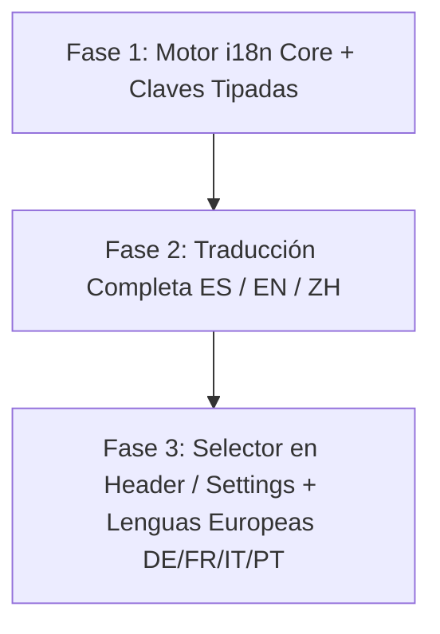

# 🌐 Plan Maestro de Internacionalización y Soporte Multiidioma (i18n) — MakoraIDE

> **Documento Estratégico y Técnico de Localización Global**
> **Proyecto:** MakoraIDE (Tauri 2 + Rust + React 19 + TypeScript)
> **Versión:** 1.0.0-i18n-Blueprint
> **Fecha:** 2026-08-19

---

## 1. Objetivos y Alcance de Idiomas

MakoraIDE se diseñó originalmente en español; este plan establece la hoja de ruta técnica para dotar al IDE de soporte multilingüe nativo con cambio en caliente y cero overhead de rendimiento.

### Idiomas Objetivo (Fase 1 y 2):
1. **Español (`es`)** — [Por defecto actual]
2. **Inglés (`en-US`)** — [Estándar global de desarrollo de software]
3. **Chino Simplificado (`zh-CN`)** — [Mercado de alta demanda en desarrollo agéntico e IA]
4. **Alemán (`de-DE`)** — [Mercado europeo clave]
5. **Francés (`fr-FR`)** — [Mercado europeo clave]
6. **Italiano (`it-IT`)** — [Mercado europeo]
7. **Portugués (`pt-BR` / `pt-PT`)** — [Mercado LATAM y europeo]

---

## 2. Arquitectura Técnica de Localización (Zero Overhead)

Para mantener la ligereza extrema del IDE y no sobrecargar el bundle de Vite (< 25KB de huella adicional), se adopta una arquitectura basada en **Diccionarios TypeScript Tipados Estrictos** con fallback dinámico.

### Estructura de Archivos:
```
src/
└── i18n/
    ├── index.ts              # Gestor central de i18n, estado de idioma y helper t()
    ├── types.ts              # Tipado estricto exhaustivo de todas las claves
    └── locales/
        ├── es.json           # Diccionario Español (Maestro de referencia)
        ├── en.json           # Diccionario Inglés
        ├── zh.json           # Diccionario Chino Simplificado
        ├── de.json           # Diccionario Alemán
        ├── fr.json           # Diccionario Francés
        ├── it.json           # Diccionario Italiano
        └── pt.json           # Diccionario Portugués
```

---

## 3. Catálogo de Namespaces de Traducción

| Namespace | Ámbito de Cobertura | Claves Clave |
|---|---|---|
| `common` | Botones universales, modales, confirmaciones | `save`, `cancel`, `confirm`, `delete`, `close`, `copy`, `copied`, `loading` |
| `header` | Barra superior, selector de tema, buscador | `workspace`, `addFolder`, `clean`, `theme`, `searchPlaceholder` |
| `workspace` | Pestañas, editores, diffs, viewers | `masterChat`, `newChat`, `splitView`, `zenMode`, `unsavedChanges` |
| `chat` | Agente, modos, turnos, thinking, prompts | `send`, `stop`, `actMode`, `planMode`, `thinking`, `toolsExecuted` |
| `git` | Git Studio, ramas, commits, remotos | `branch`, `newBranch`, `staged`, `unstaged`, `commit`, `push`, `pull`, `fetch`, `remotes` |
| `settings` | Configuración de proveedores, APIs, MCPs | `providers`, `apiKey`, `models`, `contextWindow`, `savedSecurely` |
| `analytics` | Telemetría, tokens, KV-Cache hit rate | `sessionCost`, `cacheHitRate`, `surgicalEfficiency`, `compactionRatio` |
| `systemPrompt` | Directivas maestras inyectadas al LLM | Idioma de respuesta preferido por el usuario |

---

## 4. Inyección Contextual en el Motor Agéntico (`agent.rs`)

Cuando el usuario selecciona un idioma (ej. `en` o `zh`), el cliente inyecta una directiva de lenguaje en el prompt del sistema:

```rust
// Inyección dinámica de directiva de lenguaje
let lang_instruction = match lang {
    "en" => "Language Directive: Respond in English while strictly maintaining technical code integrity.",
    "zh" => "语言指令：使用简体中文回答，同时严格保持代码和技术术语的标准性。",
    "de" => "Sprachanweisung: Antworten Sie auf Deutsch unter strikter Wahrung der technischen Code-Integrität.",
    _ => "Directiva de Lenguaje: Responde en español manteniendo la precisión técnica del código.",
};
```

---

## 5. Cronograma de Implementación (3 Fases)



1. **Fase 1 (Día 1):** Creación de `src/i18n/` con extractor automático y tipado TypeScript exhaustivo.
2. **Fase 2 (Día 2):** Traducción integral de la interfaz a Inglés y Chino Simplificado + Selector en Header.
3. **Fase 3 (Día 3):** Despliegue de Alemán, Francés, Italiano y Portugués con persistencia en `localStorage("makora.lang")`.
